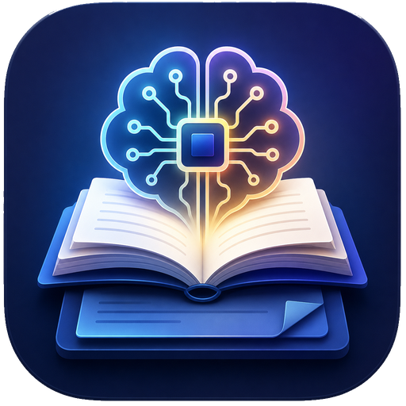
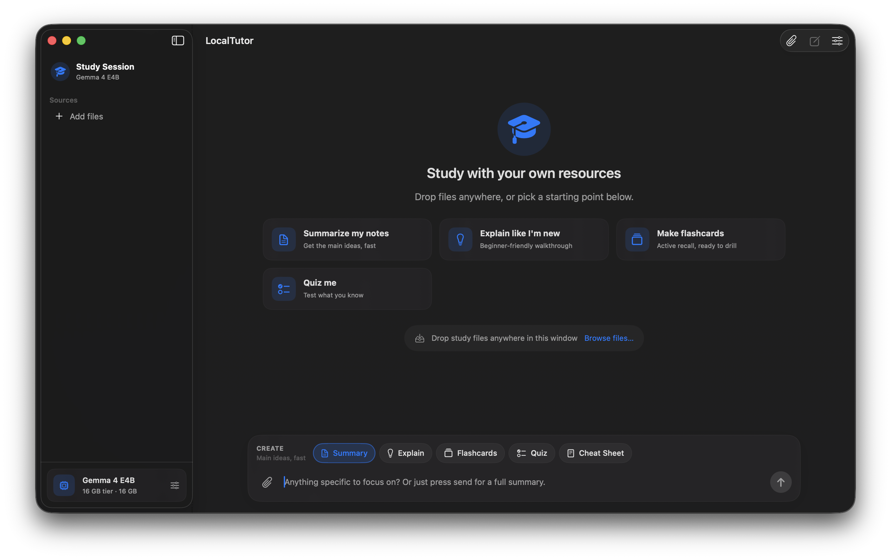

<p align="center">
  
</p>

<h1 align="center">LocalTutor</h1>

<p align="center">
  A native macOS study companion powered by on-device AI.<br />
  Drop your files, pick a model, and study — everything stays on your Mac.
</p>

<p align="center">
  
  
  
</p>

---

## Screenshots



---

## Why LocalTutor

Most AI study tools send your notes to someone else's server. LocalTutor doesn't. Every model runs on your Mac through Apple's [MLX](https://github.com/ml-explore/mlx-swift) framework, so your lecture slides, textbook PDFs, and class notes never leave your device. No API keys, no subscriptions, no cloud.

Think of it as a NotebookLM that lives entirely on your Mac.

---

## Features

### 📓 Notebooks

Each subject gets a notebook with its own sources, chats, notes, and study materials. Turn individual sources on or off to control what the tutor reads, and expand any source to see an automatic **source guide**: a short summary, key topics, and suggested questions.

| Category | Formats |
|----------|---------|
| Documents | PDF, Word (`.docx`), Pages, RTF, EPUB |
| Spreadsheets | Excel (`.xlsx`), Numbers, CSV |
| Presentations | PowerPoint (`.pptx`), Keynote |
| Web | HTML, web archives (`.webarchive`) |
| Images | JPEG, PNG, TIFF, HEIC, WebP (vision models) |
| Text | Markdown, plain text, JSON, XML |

### 💬 Chat with citations

Answers are grounded in your sources and cite them inline, like `[3]`. Click a citation to open the exact passage: PDFs open at the right page with the text highlighted. Save any answer to your notes.

When the whole notebook fits in the model's context, LocalTutor keeps it in a cached prefix, so follow-up questions reuse the already-read sources instead of starting over. Larger notebooks switch to hybrid search automatically.

### 🎓 Studio

One click turns your sources into:

- **Study Guide**: key concepts, practice questions, essay prompts, and a glossary
- **Briefing**: an executive overview of every source
- **Summary**, **Explainer**, **Cheat Sheet**
- **Flashcards** with spaced repetition (Again / Hard / Good / Easy) and a daily review queue
- **Quiz** with instant scoring and explanations
- **Mind Map**: a collapsible visual map of topics. Right-click a node to ask about it.
- **Audio Overview**: a two-host spoken recap read by on-device voices, exportable as an audio file

Flashcards, quizzes, mind maps, and audio scripts use schema-constrained decoding, so the output is always valid JSON.

### 🔍 Smart retrieval

1. **Heading matching** recognizes section numbers, chapter titles, and heading hierarchies
2. **Lexical search** uses BM25 ranking via a persistent SQLite FTS5 index
3. **Semantic search** uses on-device embeddings (Embedding Gemma 300M)
4. **Hybrid fusion** combines both with Reciprocal Rank Fusion
5. **Context packing** fits the best passages into a token budget sized for your Mac

### 🧠 Model library

LocalTutor recommends a model for your Mac on first launch and sizes the context window to your memory.

| Tier | Models |
|------|--------|
| **8 GB** | Gemma 4 E2B, Qwen3.5 4B |
| **16 GB** | Gemma 4 E4B, Qwen3.5 9B, LFM2.5 8B-A1B |
| **24 GB** | Gemma 4 12B |
| **32 GB+** | Gemma 4 26B-A4B (MoE) |

All models except LFM2.5 read images and scanned pages. Models download once from Hugging Face (standard MLX 4-bit builds) and are cached locally. On Macs with Apple Intelligence, quick tasks like source guides and chat titles run on Apple's built-in model so the tutor model stays free.

### ⚡ Performance

- Context window scales with memory: 8K tokens on 8 GB Macs up to 32K (64K in Extended mode) on 32 GB+, with an 8-bit KV cache
- Chat follow-ups continue from the cached conversation instead of re-reading every source
- Multi-token prediction (MTP) for every Gemma 4 model: a small drafter proposes several tokens at once, making long answers 1.3× (E2B) to 1.8× (26B-A4B) faster on an M4 Max, in chat and in the Studio
- Downloads can be paused, resumed (even after quitting) and cancelled; interrupted files continue from where they stopped
- Requests queue instead of failing, with live progress while sources are read
- Streaming text is isolated from notebook state, so long answers don't slow the UI
- The embedding model loads only for indexing and search, and caches are freed under memory pressure

### 🔒 Privacy

- **Fully offline** inference, indexing, and retrieval
- **App Sandbox** with security-scoped bookmarks
- **No telemetry, no accounts, no cloud**

---

## Requirements

| | Minimum | Recommended |
|---|---------|-------------|
| **macOS** | 26.0 | Latest |
| **Chip** | Apple Silicon | Apple Silicon |
| **Memory** | 8 GB unified | 16 GB unified |
| **Xcode** | 16+ | Latest |

---

## Getting started

1. **Clone and open:**

   ```bash
   git clone https://github.com/alan13367/LocalTutor.git
   cd LocalTutor
   ```

2. Open `LocalTutor.xcodeproj` in Xcode.

3. Select the **LocalTutor** scheme and press **⌘R**.

4. On first launch, LocalTutor recommends a model for your Mac. Download it, or try the sample notebook first.

5. Drop your study files into a notebook, ask a question, and open the **Studio** panel to create guides, flashcards, quizzes, mind maps, or an audio overview.

---

## Distribution

`scripts/release.sh` archives a Release build, signs it with your Developer ID, notarizes it with `notarytool`, staples the ticket, and zips the app:

```bash
xcrun notarytool store-credentials "LocalTutorNotary" --apple-id <apple-id> --team-id <TEAMID> --password <app-specific-password>
DEVELOPMENT_TEAM=<TEAMID> scripts/release.sh 1.0
```

---

## Project structure

```
LocalTutor/
├── Views/              SwiftUI: workspace, sources, chat, Studio, settings, onboarding
│   ├── State/          @Observable app state (notebooks, models, chat, studio)
│   └── Components/     Markdown, flashcards, quiz, mind map, audio overview
├── Services/           Model runner, extraction, indexing, retrieval, persistence
├── Models/             Notebooks, model profiles, runtime policies, study payloads
├── Resources/          Model catalog, sample notebook, string catalog
└── Support/            Constants, helpers, file paths

LocalTutorTests/        Unit tests (Swift Testing) + opt-in real-model integration tests
scripts/release.sh      Archive, notarize and staple a Developer ID build
```

## Tech stack

- **SwiftUI** — native macOS interface with `NavigationSplitView`
- **[MLX Swift](https://github.com/ml-explore/mlx-swift)** + **[mlx-swift-lm](https://github.com/ml-explore/mlx-swift-lm)**: on-device LLM, VLM and embedding inference, plus guided JSON generation
- **FoundationModels**: Apple Intelligence for lightweight helper tasks
- **AVFoundation**: on-device speech for audio overviews
- **PDFKit**: citation viewer with page navigation and highlighting
- **[swift-huggingface](https://github.com/huggingface/swift-huggingface)** — model downloads from Hugging Face Hub
- **SQLite / FTS5** — persistent source indexing and full-text search
- **CryptoKit** — content fingerprinting for cache invalidation
- **Accelerate / vDSP** — fast vector similarity for semantic search

## License

[MIT](LICENSE) — Copyright (c) 2026 Alan Beltran Pozo
